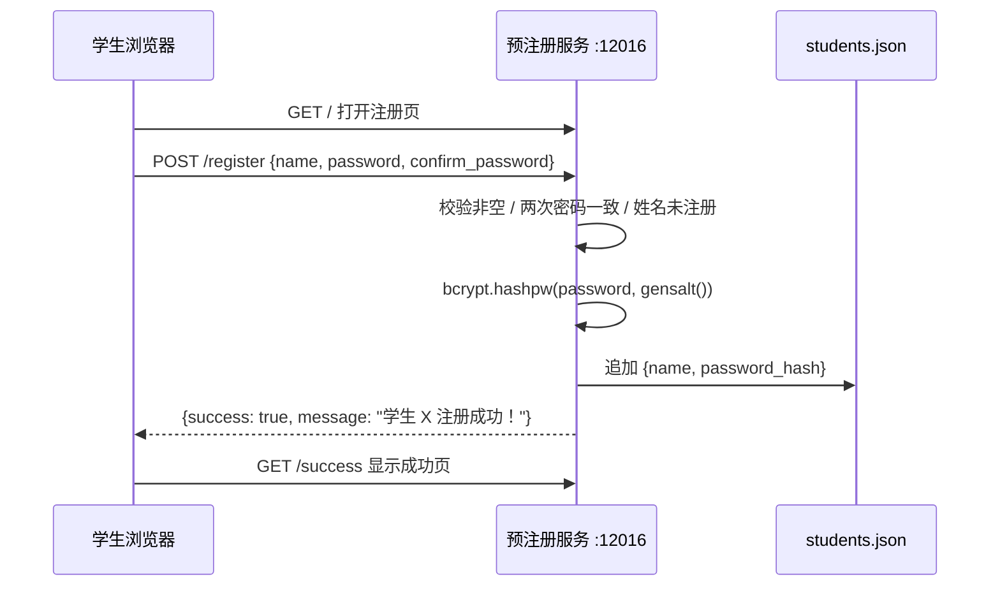

# ImageLabelTS 预注册服务（pre-registration）

学生**自助注册**服务。学生通过 Web 表单提交姓名与密码，服务端使用 **bcrypt** 生成密码哈希，并追加写入 `students.json`。该文件随后会被教师端服务同步到数据库。

## 技术栈

- **后端**：Python 3.8+，Flask
- **依赖**：`Flask`、`bcrypt`
- **前端**：原生 HTML + JavaScript

## 快速开始

```bash
cd pre-registration
pip install Flask bcrypt
python server.py
```

默认监听 `0.0.0.0:12016`。

## 注册流程



## 路由

| 方法 | 路径 | 说明 |
|------|------|------|
| `GET` | `/` | 注册表单页（`register.html`） |
| `POST` | `/register` | 处理注册，返回 JSON |
| `GET` | `/success` | 注册成功页（`success.html`） |
| `GET` | `/health` | 健康检查，返回 `{"status": "ok"}` |

### `POST /register`

表单字段：

| 字段 | 说明 |
|------|------|
| `name` | 学生姓名（去首尾空格），需唯一 |
| `password` | 密码 |
| `confirm_password` | 确认密码，需与 `password` 一致 |

成功响应 `200`：

```json
{ "success": true, "message": "学生 张三 注册成功！" }
```

失败响应 `400`：

```json
{ "success": false, "message": "该姓名已注册" }
```

可能出现的失败信息：`姓名不能为空`、`密码不能为空`、`两次输入的密码不一致`、`该姓名已注册`。

## 数据文件

`students.json`（数组，元素含 `name` 与 `password_hash`）：

```json
[
  { "name": "张三", "password_hash": "$2b$12$..." }
]
```

文件不存在时按空列表处理并自动创建。

## 目录结构

```
pre-registration/
├── server.py          # Flask 应用
├── static/            # 静态资源（当前为空）
└── templates/
    ├── register.html
    └── success.html
```

## 注意事项

- 本服务与教师端**共用同一份 `students.json`**，请确保两者指向同一个目录/文件；注册后需重启教师端或由教师端重新同步，学生才能使用新账号登录。
- 服务未对注册请求做验证码或频率限制，若暴露在公网建议在前置网关添加限流与鉴权。
- 密码哈希使用 bcrypt 的默认 cost；如需更高强度可调整 `gensalt(rounds=...)`。
