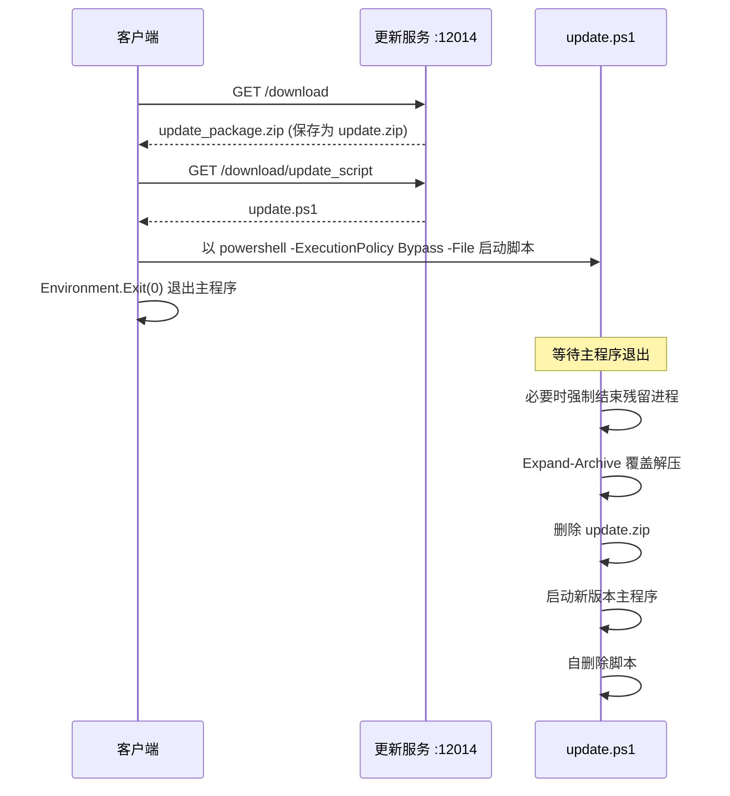

# ImageLabelTS 更新服务（update_server）

客户端**自动更新**分发服务。学生端主界面的「更新」菜单会调用本服务下载更新包与升级脚本，随后由脚本完成覆盖安装。

## 技术栈

- **后端**：Python 3.8+，Flask
- **依赖**：`Flask`
- **升级脚本**：PowerShell（`update.ps1`）

## 快速开始

```bash
cd update_server
pip install -r requirements.txt
python server.py
```

默认监听 `0.0.0.0:12014`。

## 部署前准备

服务目录下需放置两个文件（**注意：不在版本控制中，需手动部署**）：

| 文件 | 说明 |
|------|------|
| `update_package.zip` | 新版客户端完整包（解压后即覆盖客户端目录） |
| `update.ps1` | 升级脚本，仓库中已提供 |

> 若 `update_package.zip` 缺失，`/download` 会返回 `404 更新包不存在，请联系管理员`。

## 路由

| 方法 | 路径 | 说明 |
|------|------|------|
| `GET` | `/download` | 返回 `update_package.zip`，下载名 `client_update.zip` |
| `GET` | `/download/update_script` | 返回 `update.ps1`，下载名 `update.ps1` |
| `GET` | `/health` | 健康检查，返回 `{"status": "ok"}` |

## 更新流程



客户端将 `config.json` 中的 `update_server_url` 作为基地址，并自动拼接：

- 更新包：`<update_server_url>`
- 升级脚本：`<update_server_url>/update_script`

## `update.ps1` 参数

| 参数 | 默认值 | 说明 |
|------|--------|------|
| `-AppName` | `ImageLabelTS.client.exe` | 主程序文件名 |
| `-ZipFile` | `update.zip` | 待解压的更新包名 |
| `-WaitSeconds` | `3` | 等待主程序退出的秒数 |

脚本步骤：等待 → 强制结束残留进程 → 覆盖解压 → 删除压缩包 → 启动新版本 → 自删除。

## 目录结构

```
update_server/
├── server.py            # Flask 应用
├── requirements.txt
├── update.ps1           # 升级脚本
└── update_package.zip   # 更新包（需自行放置，已被 .gitignore 忽略）
```

## 注意事项

- 更新包应为**客户端完整目录结构**的压缩包，解压后直接覆盖原目录，脚本不会做差量合并或备份。
- 脚本以 `-ExecutionPolicy Bypass` 运行，且会强制结束同名进程，请确保线程安全地执行更新（提示用户保存工作）。
- 建议为更新服务配置 HTTPS 与访问控制，避免被非授权客户端拉取。
